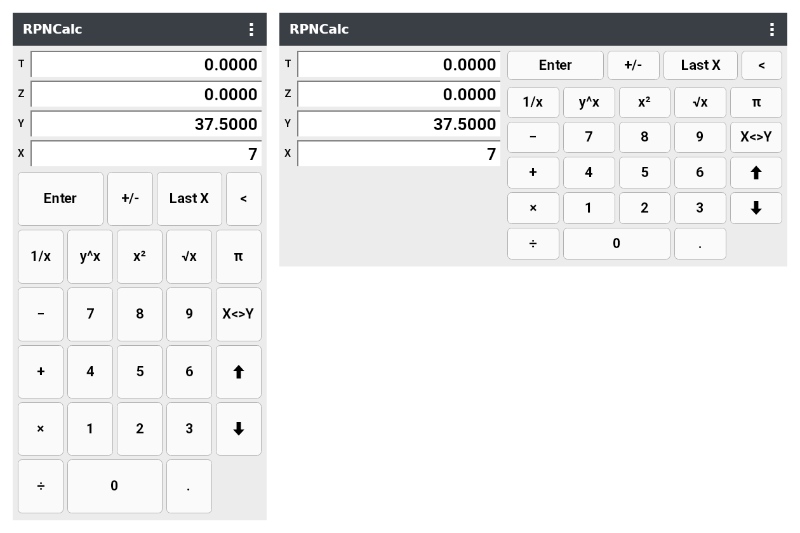

# RPN Calculator for Windows and macOS

This is a modern re-implementation of my 1997 Delphi **RPNCalc**.

- **Windows 10/11:** a single portable `RPNCalc.exe` with no installer, no .NET install and no registry use. It is written in C# with WinForms on .NET 8, self-contained for win-x64, and is per-monitor DPI aware (PerMonitorV2).
- **macOS 11+ (Apple Silicon) / 10.15+ (Intel):** a self-contained `RPNCalc.app` built with [Avalonia UI](https://avaloniaui.net/) on .NET 8. It uses the same calculator engine, layout, menus and keys as the Windows version. See [macOS](#macos).
- **Android 7.0+ (test build):** a sideloadable `RPNCalc-android.apk` built with Avalonia UI on .NET 10. It is the same engine and menu in a full-screen touch layout. See [Android](#android).

## Download (Windows)
Download the latest `RPNCalc.exe` from the [Releases page](https://github.com/dehidding/RPNCalc/releases/latest). It is a single self-contained Windows x64 file: no installer and no .NET install needed. The exe is unsigned, so Windows SmartScreen may show a warning the first time you run it (click **More info → Run anyway**).

## macOS
### Download
Download the zip for your Mac from the [Releases page](https://github.com/dehidding/RPNCalc/releases/latest):

| Mac | File |
|---|---|
| Apple Silicon (M1/M2/M3/M4…) | `RPNCalc-mac-arm64.zip` |
| Intel | `RPNCalc-mac-x64.zip` |

Not sure which one you need? Click  → **About This Mac**. "Chip: Apple M…" means arm64; "Processor: Intel" means x64.

Double-click the zip to unpack it, then drag **RPNCalc.app** into your **Applications** folder. No .NET install is needed.

### First launch (Gatekeeper)
The app is ad-hoc signed but not notarized by Apple, so the first time you open it macOS will say that it "cannot be opened" or that Apple "cannot check it for malicious software". Use **one** of these:

1. **Right-click** (or Ctrl+click) RPNCalc.app in Finder → **Open** → **Open**. On macOS 15 (Sequoia) and newer this button may not appear; use option 2 or 3 instead.
2. Open **System Settings → Privacy & Security**, scroll down to the message about RPNCalc and click **Open Anyway**, then confirm.
3. In Terminal, remove the download quarantine flag:
   ```bash
   xattr -cr /Applications/RPNCalc.app
   ```

After the first successful launch it opens normally.

### Mac specifics
- **Right-click, two-finger click or Ctrl+click** anywhere on the window opens the same menu as on Windows.
- The **RPNCalc** menu in the menu bar has **About RPNCalc** and **RPNCalc Help**, next to the standard macOS items such as Quit.
- **Cmd+C / Cmd+V** copy X and paste into X. Ctrl+C / Ctrl+V also work.
- **Cmd+Q** quits and **Cmd+W** closes the window; both save your settings and stack.
- **Cmd+?** (Cmd+Shift+/) opens Help.
- The app is Retina-aware (`NSHighResolutionCapable`), so text and buttons are rendered sharply.

### Keyboard on a Mac without a numeric keypad
MacBooks and the compact Magic Keyboard have no numeric keypad. Use these keys instead (an external keypad works too):

| Action | Mac key |
|---|---|
| Add `+` | Shift+= |
| Subtract `-` | - |
| Multiply `*` | Shift+8 |
| Divide `/` | / |
| Enter | return |
| Delete last digit | delete (⌫) |
| Clear X | esc, or fn+delete (forward delete) |
| Help | Cmd+?, or fn+F1 (F1 on keyboards with standard function keys) |

The letter keys S, L, X and P and the ↑/↓ arrows work exactly as on Windows (see [Keyboard](#keyboard)).

### Settings file on macOS
```
~/Library/Application Support/RPNCalc/settings.json
```
It works the same way as on Windows (see [Settings file](#settings-file)). To reset everything, quit RPNCalc and delete this file. In Finder, press Shift+Cmd+G and paste the folder path to find it.

## Android


### Install (sideload the test APK)
`dist/RPNCalc-android.apk` is a signed **test** build (self-signed test key, not from Google Play) for 64-bit ARM phones and tablets plus x86-64 emulators and Chromebooks. It needs Android 7.0 (API 24) or newer.

1. Copy the APK to the phone and open it in **Files**, or download it on the phone.
2. Android asks you to allow installs from that app (Files, Chrome…). Tap **Settings → Allow from this source**, go back and tap **Install**. Google Play Protect may warn about an unknown developer; tap **More details → Install anyway**.
3. Alternatively, with USB debugging enabled: `adb install -r dist/RPNCalc-android.apk`.

Later test builds signed with the same key install over this one and keep your settings. A build signed with a different key must be uninstalled first, which deletes the settings.

### Differences from the desktop versions
- **The menu** opens from the **⋮** button in the top bar, or by **long-pressing the display**. It has the same items as on the desktop, plus **Copy X** and **Paste X**. **Stay on Top** is left out because Android apps run full screen and have no overlapping windows.
- **Full-screen layout:** the keys stretch to fill the screen. In landscape the registers move to the left and the keys to the right. **Font Size** changes the register digits as on the desktop.
- **Help and About** open as full-screen pages. The **←** button, the Android **Back** button/gesture or Esc closes them.
- **Conversions → Edit Conversions...** opens an in-app CSV editor. Each skipped line is listed with its reason while you type. The editor has **Reset to defaults**, plus **Import...** and **Export...** buttons that use the system file picker (Downloads, Drive, etc.).
- **Storage:** `settings.json` and `conversions.csv` are kept in the app's private storage. They are saved shortly after every change and whenever the app goes to the background. Clearing the app's storage in Android Settings restores the defaults.
- **Hardware keyboard:** a USB or Bluetooth keyboard uses the same keys as the desktop (digits, operators, Enter, Backspace, Esc, S/L/X/P, ↑/↓, Ctrl+C/V, F1). The mapping is shared with the macOS version (`src/Shared/KeyMapper.cs`).

### Building the APK
You need the .NET 10 SDK with the Android workload (`dotnet workload install android`), the Android SDK (platform 36, build-tools 36) and JDK 17 or 21. Signing passwords are read from environment variables and are never stored in the repository:

```bash
export ANDROID_HOME=~/Android/sdk JAVA_HOME=/path/to/jdk-21
export RPNCALC_KEYSTORE_PASS='choose-a-password'   # a test keystore is created on first use
./build/android/build-android.sh                   # -> dist/RPNCalc-android.apk (signed, arm64 + x64)
```

The script runs `dotnet publish src/RPNCalc.Android -c Release` with the signing properties, then verifies the result with `apksigner` and `aapt`. `src/RPNCalc.Android` is deliberately **not** in `RPNCalc.sln`, so `dotnet build` / `dotnet test` on the solution keep working on machines without the Android workload.

## Features
- HP-style four-level stack (X, Y, Z, T) with **Last X**:
  - **Enter** copies X into Y, and the next number you type replaces X.
  - After an operation, the next number you type pushes the stack first.
  - Last X is saved before every operation and conversion.
  - Errors leave the stack unchanged and show a message: Divide by Zero, Invalid Input (for example √ of a negative number), and Overflow.
- Classic layout:
  - Stack panel with T/Z/Y.
  - X register with **Enter**, **+/-**, **Last X** and **<**.
  - Keypad: 1/x, y^x, x², √x and π on top; digits; − + × ÷ in the left column; X<>Y, Roll Up (bold ▲ arrow) and Roll Down (bold ▼ arrow) in the right column.
- Right-click menu:
  - Show Stack, Show Keypad and Stay on Top.
  - Decimal Places 0-9 in two columns (0-4 | 5-9).
  - Format Type: Fixed or Scientific, with check marks.
  - Font Size: Larger or Smaller.
  - Conversions.
  - Help and About.
- The window shrinks to fit when the stack or keypad is hidden. You can drag its left or right edge to make it wider.
- Long numbers automatically shrink so they fit in their register.
- Help window: press **F1** or use right-click → Help.

### Conversions (X is multiplied by the factor)
The Conversions menu is built from a 3-column CSV file stored next to `settings.json`:

```
%APPDATA%\RPNCalc\conversions.csv                         (Windows)
~/Library/Application Support/RPNCalc/conversions.csv     (macOS)
```

- Columns: **From** (source unit), **To** (target unit), **Factor**. Each line appears in the menu as "From → To", and choosing it multiplies X by Factor.
- Use `.` as the decimal point. Put a name that contains a comma in double quotes. Blank lines, lines starting with `#`, and a header line on the first row are ignored.
- The file is re-read every time the menu opens, so edits take effect without a restart. **Conversions → Edit Conversions...** opens the file: on Windows in the app associated with `.csv` files, on macOS in the default text editor.
- If a line is invalid it is skipped, and the menu shows "⚠ N line(s) skipped". Help lists each skipped line and the reason.
- If the file doesn't exist, it is created from the built-in list (26 conversions: volume units, Grams → lbs./M and lbs, and Cubic Inches → weight for common plastics and metals). Delete it to get the built-in list back. The built-in list is `src/RPNCalc.Engine/conversions.csv`.
- An existing conversions.csv is never overwritten, so after upgrading you keep your own list. Delete it (or copy the new one in) to get the new built-in list.

```csv
From,To,Factor
Grams,lbs./M,2.2
Inches,Centimeters,2.54
"Feet, US survey",Meters,0.3048006096
```

The default file contains:

| Conversion | Factor |
|---|---|
| Cubic Inches → Fluid Ounces (US) | 16.387064 / 29.5735295625 (≈ 0.5541125541) |
| Cubic Inches → Milliliters | 16.387064 (exact) |
| Fluid Ounces (US) → Cubic Inches | 1.8046875 (exact) |
| Fluid Ounces (US) → Milliliters | 29.5735295625 (exact) |
| Milliliters → Cubic Inches | 1 / 16.387064 |
| Milliliters → Fluid Ounces (US) | 1 / 29.5735295625 |
| Grams → lbs./M | 2.2 ("M" is Roman numeral for 1,000) |

## Keyboard
Both the main keyboard and the numeric keypad work.

| Key | Action |
|---|---|
| 0-9, `.` | Type a number (`,` from the NumPad decimal key is also accepted) |
| `+` `-` `*` `/` | Add, subtract, multiply, divide |
| Enter / NumPad Enter | Enter |
| Backspace | Delete the last digit (clears X when you are not typing) |
| Esc / Delete | Clear X *(new)* |
| S | Change sign |
| L | Last X |
| X | Exchange X and Y |
| P | π |
| Up Arrow | Roll Up |
| Down Arrow | Roll Down |
| Ctrl+C / Ctrl+V | Copy X / paste a number into X *(new)* |
| F1 | Help |

Buttons never keep keyboard focus. Enter, the arrow keys and Space always go to the calculator, even right after you click a button.

## Settings file
Settings are loaded on start and saved on close to:

```
%APPDATA%\RPNCalc\settings.json                          (Windows)
~/Library/Application Support/RPNCalc/settings.json      (macOS)
```

The file contains the window position and width, decimals, Fixed/Scientific format, show stack, show keypad, stay on top, font size, and the stack values X, Y, Z, T and Last X.

- If the file is missing or corrupt, the defaults are used.
- If a value is out of range, it is clamped to a valid value.
- If the saved position is no longer on any monitor, the window is moved onto the primary screen.
- To reset everything, delete the file.

The conversions list is kept separately in `conversions.csv` in the same folder (see [Conversions](#conversions-x-is-multiplied-by-the-factor)).

## Project layout
```
RPNCalc.sln
src/RPNCalc.Engine/        Platform-independent engine: stack, operations, conversions, formatting, JSON settings
src/RPNCalc/               WinForms GUI (MainForm, HelpForm, AboutForm), icon from the original exe
src/RPNCalc.Mac/           macOS GUI (Avalonia UI): MainWindow, Help/About dialogs, app menu
src/RPNCalc.Android/       Android GUI (Avalonia UI, net10.0-android; not in the .sln): CalculatorView, overlays, MainActivity
src/Shared/                Source linked into the macOS and Android GUIs (keyboard mapping, arrow shapes)
tests/RPNCalc.Engine.Tests xUnit tests for the engine (run on Linux or Windows)
tests/RPNCalc.Mac.Tests    Headless Avalonia UI tests for the macOS GUI (keys, menu, layout, save/restore)
build/mac/                 rpncalc.icns and package-mac.sh (builds and zips RPNCalc.app)
build/android/             build-android.sh (builds, signs and verifies dist/RPNCalc-android.apk)
docs/                      Reconstruction spec recovered from the original 1997 Rpncalc.exe
```

## Building
You need the .NET 8 SDK. The same commands work on Windows, Linux and macOS. Cross-building from Linux is enabled with `EnableWindowsTargeting`.

```bash
dotnet test tests/RPNCalc.Engine.Tests                       # run the engine unit tests
dotnet publish src/RPNCalc/RPNCalc.csproj -c Release -o dist # -> dist/RPNCalc.exe (single file, self-contained, win-x64)
```

On Windows you can also open `RPNCalc.sln` in Visual Studio 2022 and press F5.

### macOS app bundles
`build/mac/package-mac.sh` runs on Linux or macOS. It publishes self-contained single-file builds for `osx-arm64` and `osx-x64`, wraps each in `RPNCalc.app` (Info.plist, icon, executable bits), ad-hoc signs it, and writes `dist/RPNCalc-mac-arm64.zip` and `dist/RPNCalc-mac-x64.zip`. Signing uses `codesign` on a Mac, or [`rcodesign`](https://github.com/indygreg/apple-platform-rs) on Linux if it is on the PATH. The `dist/` folder is git-ignored.

```bash
dotnet test                       # engine tests + headless macOS GUI tests
./build/mac/package-mac.sh        # -> dist/RPNCalc-mac-arm64.zip, dist/RPNCalc-mac-x64.zip
```

## License
Copyright © David Hidding 2026. Apache License 2.0. See [LICENSE](LICENSE).
